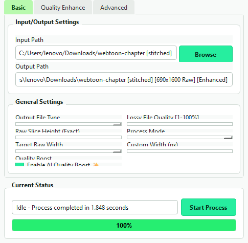

# Webtoon Raw Resizer & Enhancer 🎨
**A professional desktop utility for Webtoon & Manhwa scanlation teams and editors.**

Convert full-length stitched webtoon chapters or phone screenshots (1080p) into official Naver Webtoon raw dimensions (**690 x 1600 px** or custom sizes), while applying smart inking enhancement, dialogue text sharpening, and background noise reduction.



---

## ✨ Features

- **Exact Raw Slicing (`690 x 1600 px`):**
  Stitches fragmented chapter pieces and slices them into standard Naver Webtoon raw pages (`690x1600`) seamlessly.
- **Smart Long Strips Mode:**
  Option to stitch and output long editorial strips (e.g., ~10,000 px height) for cleaning and redrawing.
- **AI Quality & Ink Enhancement:**
  - **Smart Line & Text Sharpening:** Restores crisp dialogue speech bubbles and line art softened by mobile screen captures.
  - **Denoise & De-Artifact:** Cleans compression noise and gradient banding in gutters and panels.
  - **Black Density Boost:** Intensifies line contrast for authentic manhwa ink appearance.
  - **2x Super Resolution:** Optional 2x upscale with detail preservation.
- **High-Precision Resampling:**
  Powered by high-quality **Lanczos** interpolation to prevent blurriness.
- **SmartStitch-Inspired Interface (PySide6):**
  Clean, lightweight, modern UI with complete **Drag & Drop** folder support.
- **Multi-Threaded & Fast:**
  Batch processes 100+ images in seconds without freezing the user interface.
- **Flexible Formats:**
  Export to `.jpg` (with adjustable quality 1-100%), `.png`, or `.webp`.

---

## 🚀 Quick Start (Installation)

### Prerequisites
- Python 3.10 or higher installed. (Make sure Python is added to your system `PATH`).

### 1. Clone or Download
```bash
git clone https://github.com/Tatsumi25293/webtoon-raw-resizer.git
cd webtoon-raw-resizer
```
*(Or click **Code -> Download ZIP** on GitHub and extract the folder).*

### 2. Install Requirements
Run in your terminal / command prompt:
```bash
pip install -r requirements.txt
```

### 3. Run Application
- **Windows:** Simply double-click **`Start_Webtoon_Resizer.bat`**
- **Or via Command Line:**
  ```bash
  python main.py
  ```

### Optional: Create Desktop Shortcut (Windows)
Run this command once to place a handy shortcut on your Windows Desktop:
```bash
python create_shortcut.py
```

---

## 📖 How to Use

1. **Select Input Folder:**
   Drag and drop any chapter folder directly into the application window, or click **Browse**.
2. **Choose Output Settings:**
   - **Target Raw Width:** Default is `690 px` (Official Naver Raw standard).
   - **Raw Slice Height:** Default is `1600 px`.
   - **Process Mode:**
     - *Exact 690x1600 Raw Slices* (Recombines and slices to 690x1600).
     - *Keep Original Image Slices* (Resizes individual images directly).
3. **Quality Enhancement:**
   Keep `Enable AI Quality Boost ✨` checked for automatic ink & line restoration, or visit the **Quality Enhance** tab to customize presets and sliders.
4. **Click Start Process:**
   The output folder will be generated automatically next to your source folder and opened upon completion!

---

## 🇸🇦 دليل الاستخدام السريع (باللغة العربية)

أداة مخصصة لفرق ترجمة وتبييض المانهوا والويب تون لتحويل الفصول المسحوبة بسكرين شوت (1080p) إلى أبعاد الراو الرسمي الكوري بدقة وجودة فائقة:

1. **طريقة التشغيل:**
   - قم بتثبيت المتطلبات عبر تشغيل الأمر: `pip install -r requirements.txt`.
   - اضغط مرتين على ملف `Start_Webtoon_Resizer.bat` ليفتح البرنامج مباشرة.
   - لإنشاء اختصار سريع على سطح المكتب، شغّل: `python create_shortcut.py`.
2. **الاستخدام:**
   - اسحب مجلد الفصل وأفلته داخل البرنامج (Drag & Drop).
   - البرنامج مضبوط افتراضياً على المقاس الكوري الرسمي للراو (`690x1600`).
   - اضغط **Start Process** وسيقوم البرنامج بدمج وتقطيع وتحسين الصور وحفظها في مجلد جديد فوراً.

---

## 📄 License
This project is licensed under the [MIT License](LICENSE).
